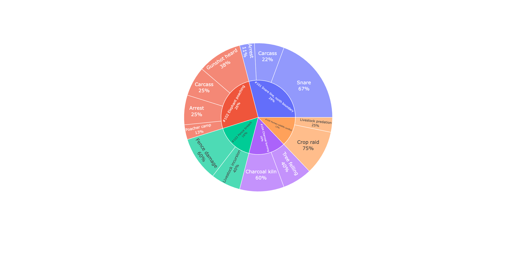

# Incident Sunburst Plot

An EarthRanger workflow that downloads **incidents** (ER's collections of related events) with **all of their events**, and shows them as a **sunburst**: incidents in the inner ring, each incident's event types in the outer ring, every slice sized by its number of events. Click a slice to zoom in.

It is one output of the incident report, split out on its own so it can be combined with other outputs elsewhere.



## Output

| Output | Shows |
|---|---|
| Events by incident and event type (widget) | Inner ring: incidents. Outer ring: their event types, in the incident's colour. Hover shows the count, % of parent and % of total. |

Incidents take their colours from the default palette, and each outer slice takes its incident's colour. So, unlike the storyboard, event types here don't use the shared event-type colours.

## Parameters

| Parameter | Notes |
|---|---|
| Data Source | EarthRanger connection |
| Time Range | Selects incidents by their own date. **All** of an incident's events are included, even those dated outside the range. |
| Group by | Optional. **Incident** gives one dashboard view per incident. |
| Show only the biggest incidents (advanced) | Empty (the default) shows every incident. A number, e.g. 10, keeps the 10 incidents with the most events and joins the rest into one grey "Other (k values)" slice; inside each incident, event types beyond its 10 most common are joined the same way. A single leftover keeps its own slice. Click "Other" to see the grouped incidents by name, and click one of them for its event types. |

## How it works

```
get_incident_events          incidents in the range → their events, with display names
  → split_groups (Incident, or all)
  → draw_sunburst_chart (rings: incident, event_type_display; expand_other) → persist_text → plot widget
  → gather_dashboard
```

Every task is from `ecoscope-platform` (≥ 2.37.0). Nested incidents are followed up to 5 levels deep (`max_depth: 5`, fixed in `spec.yaml`).

## Local development

```bash
make compile          # compile spec.yaml and install the workflow env
make run-mock         # run on mock-io/ data and preview the dashboard
make run              # run on real data (param.yaml)
make test CASE=wd-by-incident
```

To try unreleased ecoscope changes, compile against the released ecoscope-platform and put a local checkout first on the path (an editable pypi install of ecoscope conflicts with the conda solve's sqlalchemy):

```bash
PYTHONPATH=../ecoscope make run-mock
```

Mock data: `mock-io/get-incident-events.example-return.parquet` (Wildlife Dynamics site, 4 incidents, 8 events), used through `WT_TASK_MOCK_IO__ECOSCOPE_PLATFORM_TASKS_IO_GET_INCIDENT_EVENTS` in the Makefile.

## Release

Bump `ecoscope-workflows-incident-sunburst-plot-workflow/VERSION.yaml` in a PR to `main`; CI checks the compiled files are up to date, runs every test case (`dev/run-test-cases.sh --all`) and, on merge, tags `vX.Y.Z` and creates the GitHub release. Compile with `make compile`, which builds the `gcp` variant the web app runs.
