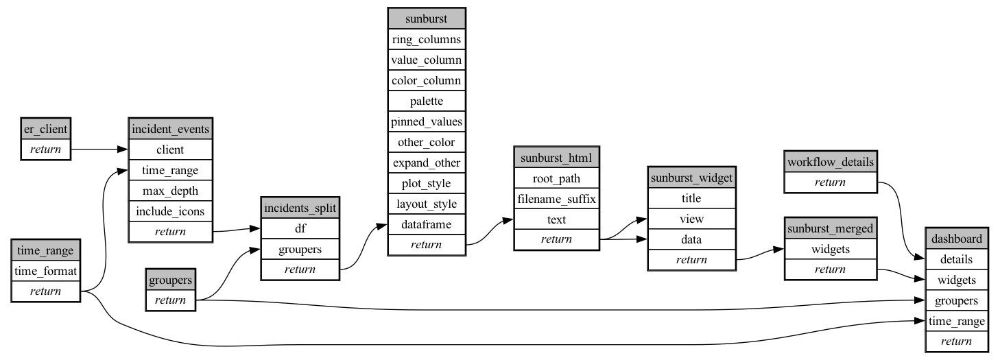

```
# AUTOGENERATED BY ECOSCOPE-WORKFLOWS; see fingerprint in README.md for details

```

```yaml
# fingerprint:
artifacts_sha256_basic: 65f4ba1bde6b0ca2081ece25be009c9df7d973da7fe16d4afebe9aa78b175a3e
artifacts_sha256_strict: b1cbe8000463ffa484d6d4cd8fba9d494eb3761fdb6e5eac7b3a1c83311440ae
installed_requirements:
- channel: https://repo.prefix.dev/ecoscope-workflows/
  name: ecoscope-platform
  version: {version: ==2.37.0}
- channel: conda-forge
  name: pydeck
  version: {version: ==0.9.2}
params_sha256: 0182e189c19301c0bf0e0ddec197368e7a11e7835a823124353a1fab4ae54fe5
spec_sha256: a62d8b0402d78478f99d5cebdd9acc142ad6fb3ae1398263e3d7dc70ce9b1d49

```

# ecoscope-workflows-incident-sunburst-plot-workflow


